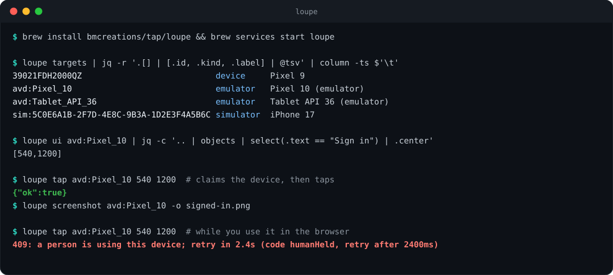
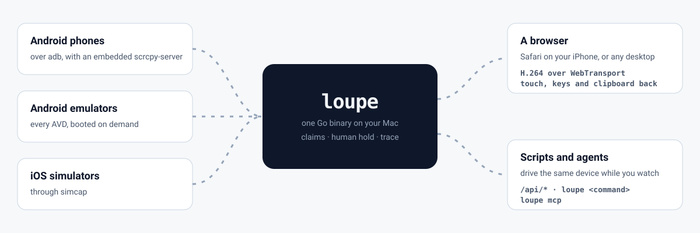

<p align="center">
  
</p>

<p align="center">
  
  
  
  <a href="https://github.com/bmcreations/loupe/actions/workflows/ci.yml"></a>
  <a href="https://github.com/bmcreations/loupe/releases/latest"></a>
  
</p>

<p align="center">
  <b>The device on your desk, in your hand.</b><br>
  Stream Android devices, emulators and iOS simulators from your Mac to any browser at 60 fps, with live touch.<br>
  Agents drive the same device through a CLI, MCP or HTTP while you watch.
</p>

---

## Quick start

```sh
brew install bmcreations/tap/loupe
brew services start loupe
open "http://localhost:18456/?token=$(cat ~/Library/Caches/loupe/token)"
```

The picker lists every Android device on adb and every AVD you have
installed, booted or not. Open one to stream it. iOS simulators need
simcap, built with your own Xcode:

```sh
brew install --HEAD bmcreations/tap/simcap && brew services restart loupe
```

Without a certificate the service answers on loopback only. To reach it from
your phone, give it TLS:
[docs/getting-started.md](docs/getting-started.md) walks through it with
Tailscale, then pairing a phone and connecting an agent.

## Drive it from a shell or an agent

<p align="center">
  
</p>

Every command is also an MCP tool. Point Claude Code or any MCP client at
`loupe mcp` and it gets the same commands, with the same claims:

```sh
claude mcp add loupe -- loupe mcp
```

`tap` takes a node instead of a point: `loupe tap <target> --text "Sign in"`
finds it in the accessibility tree and taps its center, and `--id` and
`--desc` match the other fields. Two matches are refused with the candidates
rather than guessed at. Coordinates still work, in device pixels, the ones
`ui` reports in each node's `center`. `sequence` runs several steps in one
call, and stops at the first that fails. Drive from the accessibility tree
rather than from the video. `boot` starts a shut-down AVD or simulator, with
`--wait` for how long to wait (`0` returns at once), and `boot-status` reports
on an AVD boot still running.
[docs/cli.md](docs/cli.md) covers the commands, [docs/mcp.md](docs/mcp.md)
the tools, and [docs/agent-api.md](docs/agent-api.md) every HTTP route.

## What it does

<p align="center">
  
</p>

**Streams devices**

- **Android phones over adb.** One plugged in later appears in the picker;
  one unplugged stays listed as missing, with the reason.
- **Every installed AVD**, booted or not. Opening one boots it from a warm
  snapshot. An idle emulator is paused after 5 minutes and shut down after
  30. Reset returns one to a clean state, and New device creates an AVD from
  the system images you have.
- **iOS simulators** through [simcap](https://github.com/bmcreations/simcap).
  Physical iPhones and iPads are a preview: they stream over a cable, and
  input is still being worked on. See [docs/ios.md](docs/ios.md).
- **Devices on your other machines.** Add another loupe server as a peer
  and its targets join your picker. See
  [docs/remote-targets.md](docs/remote-targets.md).

**Feels like the device is in your hand**

- Video goes over WebTransport (HTTP/3), with WebSocket as a fallback.
  Adaptive bitrate lowers the encoder's rate when the link can't carry it
  and raises it again when the link recovers.
- Multi-touch, swipes, hardware buttons, and your phone's own keyboard.
- The clipboard works both ways, and can be shared across every open target
  and the Mac's pasteboard.
- Add it to the Home Screen and it runs full screen as an app.

**Lets agents work beside you**

- The accessibility tree with a precomputed `center` per node, tap by text,
  resource id or description, swipe, text, keys, waiting for a node, app launch, deep links, screenshots, APK install, logs, crash
  reports, boot and shutdown. On a debuggable Compose app, each node names
  the composable that drew it, with its source line.
- `camera` points an AVD's, simulator's or iPhone's back camera at an
  image, so a scanner can be tested without holding a phone up to a screen.
- An agent claims a device before it drives it. Your own input holds agents
  off, you can mark a device hands off, and viewers see an agent's cursor
  before it taps. Between an agent's calls the cursor stays where it last
  acted for 20 seconds, dimmed.
- **Flags**: box an area of the screen, write a note, and send the
  screenshot and UI tree to an agent, or interrupt one mid-task.
- **Recording** writes the encoder's output to an MP4, with no re-encode.

**Fits into your workflow**

- A GitHub Action installs a pull request's APK on a target and comments on
  the PR with a link that opens it. See [action/README.md](action/README.md).
- Extensions are separate programs that loupe proxies under `/api/ext`, and
  they can draw overlays on a device. See
  [docs/extensions.md](docs/extensions.md).
- `loupe pair` gives a device its own session, which you can revoke without
  re-keying every other device.

## Security

Anyone who can reach the port can drive every device on it, so every
request needs the shared token or a paired session, and plain HTTP is
refused on anything but loopback. The token and every session have full
access; there are no scopes yet. [docs/security.md](docs/security.md) says
what is protected and what isn't.

## Build from source

```sh
git clone https://github.com/bmcreations/loupe && cd loupe
make build
./loupe -addr 127.0.0.1:8080 -synthetic -no-devices
```

Go is all it takes. The scrcpy-server jar is embedded and the web client has
no build step, so there is no scrcpy to install and no npm. The test
pattern needs ffmpeg; it should hold about 60 fps in the stats overlay
before you plug in a device. [docs/running.md](docs/running.md) lists every
flag.

## Docs

| Doc | For |
| --- | --- |
| [getting-started.md](docs/getting-started.md) | From an install to a phone, a service and an agent |
| [cli.md](docs/cli.md) | `loupe <command>`, claims between commands |
| [mcp.md](docs/mcp.md) | `loupe mcp` and pushing flags into Claude Code |
| [agent-api.md](docs/agent-api.md) | Every `/api/*` route, claims and the human hold |
| [targets.md](docs/targets.md) | AVDs, Android devices, the phone keyboard, the clipboard, device frames |
| [ios.md](docs/ios.md) | iOS simulators, and physical iPhones in preview |
| [running.md](docs/running.md) | Every flag, the settings file, the stats overlay, tests |
| [security.md](docs/security.md) | The token, TLS, pairing and sessions |

[docs/README.md](docs/README.md) indexes the rest: architecture, the wire
protocol, flags, recording, extensions and notes for working on the code.

## Licensing

loupe is Apache 2.0. It embeds and redistributes the scrcpy-server jar,
which is also Apache 2.0; `third_party/scrcpy/LICENSE` and
`THIRD_PARTY_NOTICES.md` carry that text and the upstream attribution.
Section 6 grants no trademark rights: nothing here may imply this is scrcpy
or that Genymobile endorses it.

simcap, the iOS helper, is also Apache 2.0 and lives in its own repo,
[bmcreations/simcap](https://github.com/bmcreations/simcap). It calls
private frameworks from your own Xcode install; [docs/ios.md](docs/ios.md)
says which, and what that means for an Xcode update.

iPhone, iPad, Mac, macOS and Xcode are trademarks of Apple Inc. loupe is
not affiliated with Apple.
